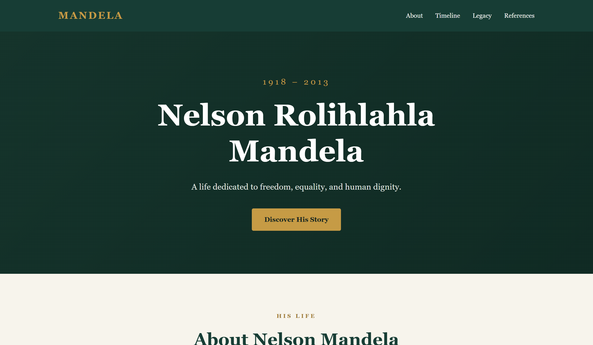
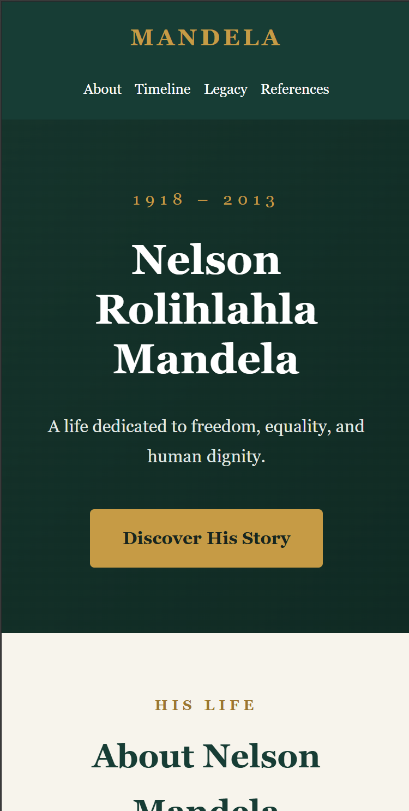

# Nelson Mandela Tribute Page

## Overview

A responsive tribute website dedicated to Nelson Rolihlahla Mandela, highlighting his life, historical contributions, and legacy.

This project was developed as part of the OIBSIP Web Development Level 2 tasks.

## Features

- Responsive design for desktop and mobile devices.
- Semantic HTML5 structure.
- Navigation links to different page sections.
- Biography and historical timeline.
- Historical references for further reading.
- Accessible skip navigation link.
- Keyboard focus indicators.
- Back to Top button.
- Automatically updated copyright year.
- Reduced-motion accessibility support.

## Technologies Used

- **HTML5** – Page structure and semantic markup.
- **CSS3** – Styling, responsive layout, and accessibility.
- **JavaScript (ES6)** – Interactive features and dynamic copyright year.

## Project Structure

```text
Web-Development-Level-2-Tribute-Page/
├── index.html
├── style.css
├── script.js
├── README.md
└── screenshots/
    ├── tribute-desktop.png
    └── tribute-mobile.png
```

## Getting Started

### Prerequisites

A modern web browser such as Google Chrome, Firefox, or Microsoft Edge.

### Installation

1. Clone the repository:

   ```bash
   git clone https://github.com/KhalidWayu/OIBSIP.git
   ```

2. Navigate to the project folder:

   ```bash
   cd OIBSIP/Web-Development-Level-2-Tribute-Page
   ```

3. Open `index.html` in your browser.

Alternatively, open the project in Visual Studio Code and use the Live Server extension.

## Responsive Design

The website includes responsive CSS breakpoints for smaller screens and mobile devices.

## Accessibility

The project includes:

- Semantic HTML elements.
- Descriptive page metadata.
- Skip-to-content navigation.
- Visible keyboard focus indicators.
- Accessible button labels.
- Reduced-motion support.

## JavaScript Functionality

- Back to Top button appears when scrolling down.
- Clicking the button smoothly returns the visitor to the top.
- Copyright year updates automatically.

## Screenshots

### Desktop View



### Mobile View



## References

- [Nelson Mandela Foundation – Biography](https://www.nelsonmandela.org/biography)
- [Nelson Mandela Foundation – Timeline](https://www.nelsonmandela.org/timeline-2)
- [Nobel Prize – Nelson Mandela](https://www.nobelprize.org/prizes/peace/1993/mandela/)

## Author

Developed as an educational web development project for OIBSIP.
